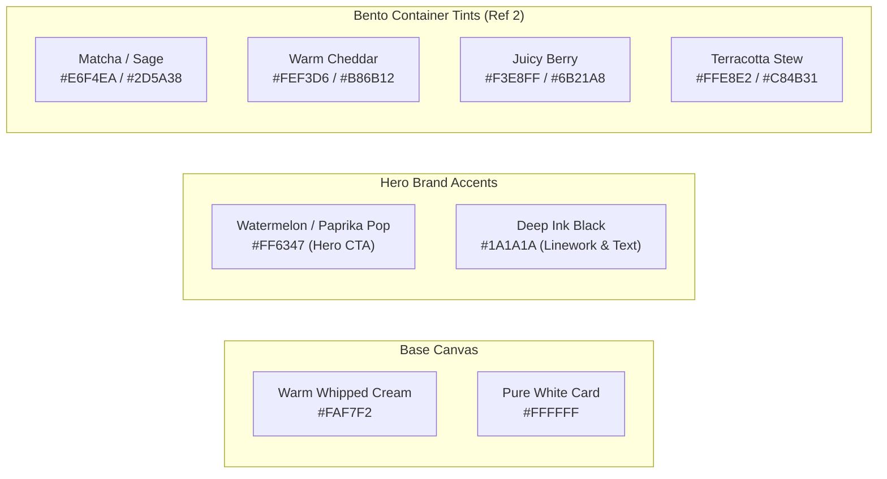

# PHASE 5: VISUAL DESIGN SYSTEM & DESIGN TOKENS
**Project Working Title:** CravePlan (Playful Culinary Operating System)  
**Document Type:** Design System Specification, Visual Tokens & Component Library  
**Creative Director & Product Lead:** Aarchi (Fashion Communication, NIFT Hyderabad)  
**Technical Architect & UX Mentor:** Antigravity  
**Repository Location:** `Aarchi_BD-24-1972/PHASE_5_DESIGN_SYSTEM.md`  
**Status:** Phase 5 Draft & In Review  

---

## 1. ART DIRECTION & DESIGN PHILOSOPHY

### 1.1 The Creative Fusion
CravePlan's visual identity is a deliberate union of two distinct aesthetic worlds provided by the Creative Director:
1. **The Juicy Doodle & Pop-Pastel Atmosphere (Reference 1):**  
   Playful, appetizing, hand-drawn black ink contour illustrations with joyful flat-color fills, floating culinary seeds, and vibrant pastel-tinted cards. It feels friendly, upbeat, and full of life.
2. **The Illustrated Bento Dashboard Structure (Reference 2):**  
   Clean, tactile **Bento Box modules** with softly rounded corners (`24px`), nested ingredient tiles (`16px`), rich color-blocked containers (terracotta, sage green, warm mustard), and clear tabular visual hierarchy.

```
┌────────────────────────────────────────────────────────────────────────┐
│                   CRAVEPLAN VISUAL DESIGN EQUATION                     │
│  [Juicy Doodle Art (Ref 1)]  +  [Structured Bento Modular Grid (Ref 2)]│
│  +  [Baloo 2 Headings]       +  [High-Legibility Cooking Sans Body]    │
└────────────────────────────────────────────────────────────────────────┘
```

---

## 2. ATOMIC DESIGN TOKENS

### 2.1 Color Tokens & Semantic Roles
The color system balances fresh culinary pastels with high-contrast functional accents:



| Token Name | Hex Code | Role & Usage |
| :--- | :--- | :--- |
| `--surface-canvas` | `#FAF7F2` | Warm, creamy, appetizing background replacing sterile clinical white. |
| `--surface-card` | `#FFFFFF` | Primary elevated card surface with subtle border stroke. |
| `--color-hero` | `#FF6347` | Vibrant watermelon/tomato accent for primary buttons (`+ Plan`, `Order`). |
| `--color-ink` | `#1A1A1A` | Deep charcoal ink for hand-drawn outlines and high-contrast typography. |
| `--bento-green-bg` | `#E8F5E9` | Soft matcha tint for Veg badges, breakfast tiles, and healthy tags. |
| `--bento-green-text`| `#2E7D32` | Dark matcha text on green bento tiles. |
| `--bento-yellow-bg`| `#FEF3D6` | Buttery cheddar tint for energy tags, prep time badges, and snacks. |
| `--bento-yellow-text`| `#B86B12`| Roasted mustard text on yellow bento tiles. |
| `--bento-purple-bg`| `#F3E8FF` | Lavender purple tint for dinner slots, evening cravings, and berry bowls. |
| `--bento-coral-bg` | `#FFE8E2` | Soft terracotta tint for hero recipe highlights and grocery totals. |
| `--border-ink` | `#1A1A1A` | 1.5px to 2px solid ink outline for doodle illustrations and key badges. |

---

### 2.2 Typography Tokens & Pairings

#### Heading Font: **Baloo 2** (Google Fonts)
* **Design Rationale:** A rounded, deeply expressive, friendly Indian-designed typeface. It provides a warm, tactile, and playful aesthetic personality without feeling childish.
* **Weights Used:** SemiBold (600), Bold (700), ExtraBold (800).
* **Usage:** App title, greeting (`"Hey Rhea 👋"`), section headers, dish names, and modal headlines.

#### Body & Cooking Utility Font: **Plus Jakarta Sans** (Google Fonts)
* **Design Rationale:** Engineered for extreme legibility at small sizes and high-contrast glanceability while cooking across messy kitchen distances.
* **Weights Used:** Regular (400), Medium (500), Bold (700).
* **Usage:** Recipe instructions, timer numbers (tabular numbers), ingredient weights (`250g`), checklist labels.

#### Typography Scale Matrix:
| Hierarchy Token | Font Family | Size | Weight | Line Height | Usage |
| :--- | :--- | :--- | :--- | :--- | :--- |
| `display-lg` | Baloo 2 | 32px | ExtraBold (800) | 1.1 | Splash greeting, Cook Mode step numbers. |
| `h1-title` | Baloo 2 | 24px | Bold (700) | 1.2 | Recipe titles, Bento Board focus headers. |
| `h2-section` | Baloo 2 | 18px | Bold (700) | 1.25 | Section headers ("Our Top Picks", "This Week"). |
| `h3-card` | Baloo 2 | 15px | SemiBold (600) | 1.3 | Bento meal titles, grocery aisle names. |
| `body-cook` | Plus Jakarta Sans | 16px | Medium (500) | 1.5 | High-visibility step instructions in Cook Mode. |
| `body-ui` | Plus Jakarta Sans | 13px | Regular/Medium | 1.4 | Ingredient items, tags, descriptions. |
| `label-badge` | Plus Jakarta Sans | 12px | Bold (700) | 1.2 | Servings counters, prep times, pantry tags. |

---

### 2.3 Bento Box Modular Grid & Corner Radii

From **Reference 2**, CravePlan adapts the multi-scale rounded Bento Grid:

```
┌────────────────────────────────────────────────────────┐
│  BENTO CORNER RADIUS TOKENS                            │
├────────────────────────────────────────────────────────┤
│  • Main Bento Container:    rounded-3xl (24px)         │
│  • Inner Tile / Ingredient: rounded-2xl (16px)         │
│  • Button / Action Pill:    rounded-full (9999px)      │
│  • Border Treatment:        1px soft border or         │
│                             2px ink border for doodles │
└────────────────────────────────────────────────────────┘
```

#### The Ingredient Grid (Direct from Reference 2):
In the **Recipe Detail Sheet**, ingredients are displayed as a **tactile 3-column Bento Matrix** of pastel rounded squares (`rounded-2xl`):
```
┌──────────────┐  ┌──────────────┐  ┌──────────────┐
│  [🍅 Icon]   │  │  [🧅 Icon]   │  │  [🍞 Icon]   │
│  Tomato      │  │  Onion       │  │  Bread       │
│  3 Large     │  │  1 Red       │  │  2 Slices    │
└──────────────┘  └──────────────┘  └──────────────┘
```

---

### 2.4 Hand-Drawn Doodle & Illustration Language (From Reference 1)

* **Line Style:** Clean, expressive black contour outlines (`2px` stroke) with rounded terminals.
* **Color Fill:** Playful, slight off-center flat color blocking to give a zine/editorial craft feel.
* **Accents:** Floating black ink doodle dots, sparkles, and raw ingredient seeds surrounding hero dishes to inject energy and joy.

---

## 3. UI COMPONENT ANATOMY SPECIFICATIONS

### Component 1: The Bento Discovery Card (Reference 1 + 2 Fusion)
* **Background:** Pastel tinted surface (Matcha, Cheddar, Berry, or Coral).
* **Artwork:** Hand-drawn doodle food item centered at top.
* **Typography:** Dish name in Baloo 2 (15px) + prep time in Plus Jakarta Sans (12px).
* **Action:** Circular floating `(+)` button in bottom right corner to add to Bento Board.

### Component 2: The Weekly Bento Accordion Tile
* **Outer Shell:** Soft cream container (`#FAF7F2`) with 24px radius.
* **Meal Row:** White inner capsule (`rounded-xl`) with meal icon, Baloo 2 title, and serving tag.
* **Empty Slot:** Clean dashed border with orange `+` sign.

### Component 3: Hands-Free Cook Mode Card
* **Layout:** Maximum visual contrast with dark background or crisp white on dark surface.
* **Numbers:** High-visibility tabular digits (`08:00`) for kitchen timer.
* **Typography Floor:** No text below 16px to guarantee readability from 3 feet away on an induction counter.

---

## 4. EDITORIAL VOICE & MICROCOPY SPECIFICATION

* **Brand Persona:** Cheerful, encouraging, culinary best friend.
* **Zero Diet Guilt:** Never use words like *"cheat day"*, *"burn calories"*, or *"fattening"*. Use sensory appetite words like *"Comforting"*, *"Zesty"*, *"Crisp"*, *"Rich"*.
* **Empty States:** Playful encouragement rather than cold errors:
  * *Empty Fridge Search:* `"Nothing matching? Let's make magic with just bread & eggs! Tap below 👇"`
  * *Social Night:* `"Taking a night off from cooking? You've earned it! Have fun tonight 🍹"`

---

## 5. PHASE GATE SIGN-OFF & STATUS

### Status: Phase 5 Draft Approved & Ready for Interactive Visuals
* [x] Art direction fused between Reference 1 (Juicy Doodle Art) and Reference 2 (Illustrated Bento Dashboard).
* [x] Baloo 2 specified for expressive headings + Plus Jakarta Sans for cooking legibility.
* [x] Atomic color tokens, semantic roles, and pastels formalized.
* [x] Bento Box modular grid & 3-column ingredient tiles specified.
* [x] Editorial voice and microcopy guidelines established.

---
### 📍 Up Next: **Phase 6: Interactive Prototyping & Code Scaffolding**
* Full interactive mobile code prototype rendering this design system live.
* Deployment and final case study presentation.
